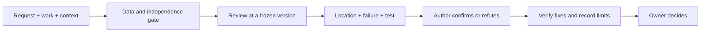

# ai-redteam

[](https://github.com/rivendale/ai-redteam/actions/workflows/checks.yml)
[](LICENSE)
[](https://github.com/rivendale/ai-redteam/releases/latest)

**A second opinion for work produced with AI.** Review a plan, challenge a claim, check a pull request,
or decide whether an incoming tool is useful. For developers, analysts and people who need evidence
before relying on an answer. Findings name the location, what can fail and how to check it.

Choose **redteam** for work and decisions, **pr-review** for a frozen pull request,
or **assess** for an incoming link or idea. A review is evidence to examine, not an approval.

## Try it in two minutes

No install needed: open the [paste-in review prompt](prompts/adversarial-review.md) in a fresh chat,
then supply these three inputs:

```text
Original request: [paste the request verbatim]
Work: [paste the plan, code, claim or draft]
Context: [stakes, constraints and evidence the reviewer may use]
```

Use a session that did not write the work. Send sensitive material only to an endpoint approved for it.
For native skills, jump to [installation by CLI](#install-by-cli). Agents start at [AGENTS.md](AGENTS.md);
[llms.txt](llms.txt) is the plain index.

## Worked example: a billing edge case

The [published synthetic example](evals/results/2026-10-07-pr9/pr-review-reports/case-10.md)
reviewed a calendar-month proration function. The request was to charge from the upgrade day to the
end of that calendar month. The code used a fixed 30-day month.

From the actual October 7, 2026 report:

> Upgrade on Jan 31 gives `remaining_days = 30-31+1 = 0`, so the charge is **0**.

Its finding at `billing/proration.py:8` proposed a regression test:
`prorated_cents(3000, date(2026,1,31), region_with_rate_0) == 97`.
The report also stated that head/base commits and a second High-tier round were missing.
This is a hand-traced historical result, not a new test run or a promise to catch every billing bug.



## Skills and paste-in prompts

The repository has three skills. Paste-in prompts are also available:

| File | Use |
|---|---|
| [`skills/redteam/SKILL.md`](skills/redteam/SKILL.md) | Adversarial review; use the host-specific invocation below |
| [`prompts/adversarial-review.md`](prompts/adversarial-review.md) | Paste-in prompt for any model (Tracks A, B and R with the current reporting schema; Tracks C and D are in the skill) |
| [`skills/pr-review/SKILL.md`](skills/pr-review/SKILL.md) | Bounded PR review; use the host-specific invocation below |
| [`prompts/pr-review.md`](prompts/pr-review.md) | Paste-in PR review prompt for any model |
| [`skills/assess/SKILL.md`](skills/assess/SKILL.md) | Assess whether a link, tool, paper or idea serves the current goals and choose the next action |
| [`prompts/assess.md`](prompts/assess.md) | Paste-in assess prompt for any model |
| [`prompts/cross-disciplinary-review.md`](prompts/cross-disciplinary-review.md) | Paste-in prompt for reviewing a claim across disciplines: prior work first, one seat per field (prompt only, no skill) |

## What redteam does

0. **Protect sensitive data**: work containing client, customer or personal data is reviewed only on models and endpoints approved for it.
1. **Reconstruct**: restates what the work claims and lists the load-bearing assumptions.
2. **Attack**: Track A for decisions and analysis (logic, assumptions, alternatives, counter-case, pre-mortem, bias, reversibility); Track B for code (correctness, requirement fit, hallucinated APIs, failure handling, security, data integrity, tests, operations, blast radius); Track C for factual claims (sources say what is claimed, verbatim quotes, recomputed numbers, freshness); Track D for ideas and proposals (need, burden, cheaper alternative, adoption, fit); Track R for regulated and customer-facing surfaces (practice written as requirement, promises, consistency with filed documents, personal data, records, stale published lists, invented controls, required statements).
3. **Self-check**: drops findings that lack a location and a concrete failure scenario.

Three rules guard against evidence that cannot fail: a zero needs a positive control, a green check is not a review, and a test that has never failed proves nothing.

Output is a verdict (SHIP / SHIP WITH FIXES / REWORK / REJECT), a severity-ranked findings table with evidence levels and separate confirmed, needs-validation and refuted states, what held up, unverified claims, questions for the author, and a plain-language owner summary with no personal data that can be forwarded as is. Critical includes regulatory or legal exposure and harm to a customer.

The [published example above](#worked-example-a-billing-edge-case) shows why a prior review does not replace evidence or a concrete regression test.

## What pr-review does

Review one exact PR head against its merge base in a throwaway checkout. Low-risk work gets one independent
read; Standard gets one round; High-risk work gets two rounds on approved endpoints. High includes auth,
permissions, migrations, money, personal data and regulated text. More rounds require owner approval.

Each P0-P3 finding names a location, failure scenario and suggested test. The author confirms or refutes it
with evidence; accepted fixes need a regression check and a read of the correction diff. A merge recommendation
requires the tier's rounds and all expected checks to be complete. The command is `pr-review`, because
Claude Code's built-in `/review` is a different command. See the [full contract](skills/pr-review/SKILL.md).

The opt-in Action runs a [bounded OSV lookup](docs/pr-review-action.md#known-bad-version-lookup) before its model
round when dependency files change. It publishes exact-version matches independently, with OSV ID, supplied
severity and advisory link. Unsupported resolution or unavailable OSV is explicit incomplete coverage.
Recorded fixtures exercise a malicious package and a clean bump without live CI requests. As of October 22, 2026, the deterministic lookup has offline coverage,
while the incident-lens comparison reports no measurable detection gain. See the dated
[results and remaining gates](#results); offline lookup tests do not establish model performance.

## What assess does

`assess` checks an incoming link or item against the user's actual goals and existing context. It separates source
claims from verified facts, checks overlap, cost and data requirements, and chooses a bounded next action. It can
recommend a trial or borrowing path, ask for an owner decision, watch, or skip. It does not buy, install, publish
or treat a sender's summary as evidence.

<a id="redteam-vs-pr-review-when-to-use-which"></a>

## Which skill to use

| Work | Use |
|---|---|
| Incoming links, products, papers and ideas: usefulness and next action | `assess` |
| Decisions, plans, analysis, wording, small diffs | `redteam` |
| Code pull requests | `pr-review` |
| High-risk changes (auth, migrations, money, personal data, regulated text) | both |

## Reference material

The [poisoned repository startup fixture](docs/tests/poisoned-repo.md) exercises
local hooks, install instructions, editor tasks and MCP startup with distinct
canaries. Its offline runner contracts and installed-CLI startup receipts are
separate evidence. The real drill fails closed without isolation or its
positive hook control.

| File | Use |
|---|---|
| [`docs/capabilities.md`](docs/capabilities.md) | Everything the repo does, grouped, with the file that owns each part |
| [`docs/SPEC.md`](docs/SPEC.md) | redteam design and failure list, version by version, each written before its skill text (the file owns its versions and item numbers) |
| [`docs/attack-catalog.md`](docs/attack-catalog.md) | Twenty-eight ways AI-built systems fail under attack, each with the question a reviewer should ask |
| [`docs/framework-mapping.md`](docs/framework-mapping.md) | The catalog and skills against OWASP LLM Top 10 2025, OWASP Agentic Top 10 2026 and MITRE ATLAS |
| [`docs/why-reviews-fail.md`](docs/why-reviews-fail.md) | How reviews of AI work go wrong, and the habit that prevents each |
| [`docs/workflow.md`](docs/workflow.md) | Where these reviews sit in a build-and-review loop |
| [`docs/using-with-ai-agents.md`](docs/using-with-ai-agents.md) | How AI CLIs read a repo, install and invoke, proving the load, pitfalls |
| [`docs/privacy-checklist.md`](docs/privacy-checklist.md) | Questions for any work that touches personal information |

Companion repos: [hsi-operator](https://github.com/rivendale/hsi-operator) (keeping a person at the strategic level of agent work),
[opensource](https://github.com/rivendale/opensource) (including `tools/web`, safe page readers), and
[local-ai](https://github.com/rivendale/local-ai) (private, on-device models).

<a id="install-the-skills"></a>

## Install by CLI

Start from a **reviewed full commit**, not a moving branch. These instructions copy files;
they do not prove the host loaded the skill. Keep support docs, schemas and tools available.

```sh
git clone https://github.com/rivendale/ai-redteam.git
cd ai-redteam
git checkout <reviewed-full-commit-sha>
```

| Host | Install and invoke |
|---|---|
| Claude Code | From the pinned clone: `claude plugin marketplace add ./`, then `claude plugin install ai-redteam@ai-redteam --scope user`. Invoke `/ai-redteam:redteam`, `/ai-redteam:pr-review` or `/ai-redteam:assess`. The [agent guide](docs/using-with-ai-agents.md#install-and-invoke) also covers personal and project skill copies. |
| Codex | Follow the tested [project-local copy recipe](docs/install-portable-skills.md#project-local-copy), with `AI_REDTEAM_HOST=codex`; it installs `.agents/skills/` and matching shared support. Invoke `$redteam`, `$pr-review` or `$assess`. Check the [official skill docs](https://learn.chatgpt.com/docs/build-skills), verified October 22, 2026. |
| Any chat or model | Paste [redteam](prompts/adversarial-review.md), [pr-review](prompts/pr-review.md) or [assess](prompts/assess.md), plus the three inputs above. No skill installer is needed. |
| Claude apps | Zip one skill folder and upload it as a custom skill. The [guide](docs/using-with-ai-agents.md) explains support paths and limits. |

For Cursor and Copilot, use the same [portable installation guide](docs/install-portable-skills.md).
After installing, start a fresh session and ask it to list the skills and quote the project instruction sentinel.
File-copy tests are separate from host loading and review quality.

<a id="use"></a>

```text
/ai-redteam:redteam the migration plan above; stakes: production data
/ai-redteam:pr-review 42
/ai-redteam:assess <link or item> for the goals in my context file
```

<a id="published-results-and-pending-work"></a>

## Results

These are dated observations on fixed cases, not a general detection guarantee. Development tuning,
hold-out checks and repeated runs answer different questions.

| Record | What it supports | Limit |
|---|---|---|
| [Three-run variance, October 16, 2026](docs/variance-2026-10-16.md) | Redteam development recall 80/84 in each repeat; hold-out hits 18/20, 18/20 and 17/20. Detection agreement 75/85 development cases and 18/22 hold-out cases. | Descriptive rescoring of published reports; no new model runs or rule-ablation claim. |
| [Release gate, October 9, 2026](evals/results/2026-10-09-gate-v232/README.md) | As-run redteam development 240/252 versus 235/252 baseline; hold-out 53/60 versus 56/60. | The hold-out candidate sits exactly at the predeclared recall floor. Later scorer interpretations do not replace these totals. |
| [Assess hold-out and correction, October 9, 2026](evals/results/2026-10-09-assess-holdout3/README.md) | As-run case passes 106/108; corrected scorer 108/108 on the same reports. | Case passes are not defect recall; this is not a new hold-out run. |
| [PR-review held-text comparison, October 8, 2026](evals/results/2026-10-08-prreview-held/README.md) | No control false alarms or violations in its limited repeated comparison. | Both held cases are controls; no detection-benefit claim follows. |
| [Week-1021 lens comparison, October 22, 2026](https://github.com/rivendale/ai-redteam/blob/120f1fbbf2ca698419b1111e0177b507d568e757/evals/results/2026-10-22-week1021-lenses/README.md) | 192 reviews requested Opus 5.5. In the paired Opus 5.5 subset, baseline recall was 42/42 development and 27/29 hold-out defect observations; no measurable lens gain. | Counts span repeats. Controls were corrected after the run; 12 reviews stopped; 17/24 pretext reviews finished with Opus 4.8, so that lens is unassessable. [Fallback accounting](evals/README.md#reviews-finished-by-a-different-model-added-2026-10-22) records this boundary. |

No model run was performed for this documentation pass.

**Remaining gates, dated October 22, 2026:** the incident lenses and evidence-check additions are on main,
but merging text is not a release-quality detection result. Corrected development cases need a new comparison;
independent hold-out provenance and model identity must be retained. The earlier supply-chain comparison
[documents safety-stop limits](evals/results/2026-10-20-supplychain-lens/README.md).
Rule-ablation runs still require separate authorization; repeats do not isolate an individual rule's contribution.
See [catalog provenance](docs/catalog-provenance.md) and the [eval requests](docs/eval-requests/README.md).

## Getting a real second opinion

- **Independence matters.** A reviewer sharing the author's context inherits its blind spots. Use a fresh session.
- **Give the original request verbatim.** Otherwise the reviewer grades against its own framing.
- **Findings are candidates.** Ask the author to confirm or refute Critical and High findings with evidence; record the outcome.
- **Protect the data.** A second opinion does not authorize sending sensitive material to a new endpoint.

## Credits

Every external source this repository adapts or cites, in one place. Per-entry credits stay where each source is used (for
example the [attack catalog's Sources](docs/attack-catalog.md#sources)); this list points to them. "Ideas" means no text or
code was copied. Licenses were read from each repository on 2026-10-08.

**Skills and audit practice**

| Source | What was taken | License | Used in |
|---|---|---|---|
| Cloudflare, [security-audit-skill](https://github.com/cloudflare/security-audit-skill) | ideas: finding states, a coverage ledger, a schema-validated findings file; comparison for catalog entries 12-28 | MIT | [SPEC v2.2](docs/SPEC.md), [redteam](skills/redteam/SKILL.md) output format, [catalog](docs/attack-catalog.md#sources) |
| Garry Tan, [gstack](https://github.com/garrytan/gstack) `/cso` skill | ideas: comparison for catalog entries 12-28 | MIT | [catalog](docs/attack-catalog.md#sources) |
| Trail of Bits, [skills](https://github.com/trailofbits/skills) | ideas only: comparison for entries 12-28; variant analysis (entry 28) | CC-BY-SA-4.0 | [catalog](docs/attack-catalog.md#sources) |

**Research**

| Source | What was taken | Used in |
|---|---|---|
| [arXiv 2609.18460](https://arxiv.org/html/2609.18460v1) | peer-handoff harm rates | catalog entry 2 |
| [arXiv 2608.27800](https://arxiv.org/html/2608.27800v1) (ContextLeak) | tool names and descriptions as an attack surface | catalog entry 3 |
| [arXiv 2607.07433](https://arxiv.org/abs/2607.07433) (HalluSquatting) | registered hallucinated names | catalog entry 8 |
| [arXiv 2606.13685](https://arxiv.org/abs/2606.13685); [arXiv 2403.18771](https://arxiv.org/abs/2403.18771) (CheckEval) | judge self-disagreement; decomposed yes/no questions | [SPEC v2.2 sources](docs/SPEC.md), severity questions |
| 1Password, [blog](https://1password.com/blog/why-ai-generated-patches-still-require-human-review) and [paper](https://1password.com/files/resources/frontier-models-vulnerability-patches-flawed.pdf) | AI security patches that fix, or add, a flaw | SPEC v2.2 sources, fix-regression check |
| [arXiv 2610.03984](https://arxiv.org/abs/2610.03984); [arXiv 2406.12952](https://arxiv.org/abs/2406.12952) (SWT-Bench); counter-result [arXiv 2602.07900](https://arxiv.org/abs/2602.07900) | reproduction tests over self-review | SPEC v2.2 sources, Track B reproduction |
| Meta, [Muse security write-up](https://research.meta.ai/blog/security-and-safety-for-ai-agents-our-approach-with-muse) | credentials outside the agent's runtime | catalog entry 4 |

**Standards, specifications and vendor documentation**

| Source | Used in |
|---|---|
| [RFC 8725](https://www.rfc-editor.org/rfc/rfc8725.html) (JWT best practices) | catalog entry 12 |
| [RFC 8659](https://www.rfc-editor.org/rfc/rfc8659.html) (CAA), [RFC 6962](https://www.rfc-editor.org/rfc/rfc6962.html) (Certificate Transparency) | catalog entry 16 |
| [CWE-295](https://cwe.mitre.org/data/definitions/295.html) (improper certificate validation) | catalog entry 15 |
| [MCP security best practices](https://modelcontextprotocol.io/specification/draft/basic/security_best_practices) | catalog entry 18 |
| GitHub: [validating webhook deliveries](https://docs.github.com/en/webhooks/using-webhooks/validating-webhook-deliveries), [Actions secure use](https://docs.github.com/en/actions/reference/security/secure-use), [npm 12 changelog](https://github.blog/changelog/2026-07-08-npm-install-time-security-and-gat-bypass2fa-deprecation/) | catalog entries 15, 23, 7 |
| Anthropic: [NIST submission](https://www-cdn.anthropic.com/43ec7e770925deabc3f0bc1dbf0133769fd03812.pdf), [Zero Trust guide](https://claude.com/resources/guides/zero-trust-for-ai-agents/security-considerations-for-autonomous-systems) | catalog entry 4 |
| Claude Code docs: [hooks](https://code.claude.com/docs/en/hooks), [memory](https://code.claude.com/docs/en/memory), [skills](https://code.claude.com/docs/en/skills) | catalog entry 22; [using-with-ai-agents](docs/using-with-ai-agents.md) |
| `ss(8)` manual page | catalog entry 26 |
| [OWASP Top 10 for LLM Applications 2025](https://genai.owasp.org/llm-top-10/), [OWASP Top 10 for Agentic Applications 2026](https://genai.owasp.org/resource/owasp-top-10-for-agentic-applications-for-2026/), [MITRE ATLAS](https://atlas.mitre.org/) ([data](https://github.com/mitre-atlas/atlas-data)) | [framework mapping](docs/framework-mapping.md) |

**Methods**

| Source | Used in |
|---|---|
| Gary Klein, ["Performing a Project Premortem"](https://hbr.org/2007/09/performing-a-project-premortem), Harvard Business Review, 2007 | Track A pre-mortem |
| John Dewey, [*How We Think*](https://www.gutenberg.org/ebooks/37423), 1910 | rival explanations in [workflow](docs/workflow.md) and [why-reviews-fail](docs/why-reviews-fail.md) item 10 |
| Mutation testing, established practice since DeMillo, Lipton and Sayward, ["Hints on Test Data Selection"](https://doi.org/10.1109/C-M.1978.218136), IEEE Computer, 1978 | redteam rule 5 (a test that has never failed); [why-reviews-fail](docs/why-reviews-fail.md) item 4; the validator's weakened-copy test ([evals/README](evals/README.md)) |

**Conventions**

| Convention | Used in |
|---|---|
| [AGENTS.md](https://agents.md/) | [AGENTS.md](AGENTS.md) |
| [llms.txt](https://llmstxt.org/) | [llms.txt](llms.txt) |
| Anthropic Agent Skills format ([Claude Code skills](https://code.claude.com/docs/en/skills), [agentskills.io](https://agentskills.io/)) | `skills/*/SKILL.md`, `.claude-plugin/` |

Measured claims (entries marked *measured* in the catalog) come from one operator's machines; the methods are in
[rivendale/hsi-operator](https://github.com/rivendale/hsi-operator) and [rivendale/opensource](https://github.com/rivendale/opensource/tree/main/tools/web).

## License

MIT
